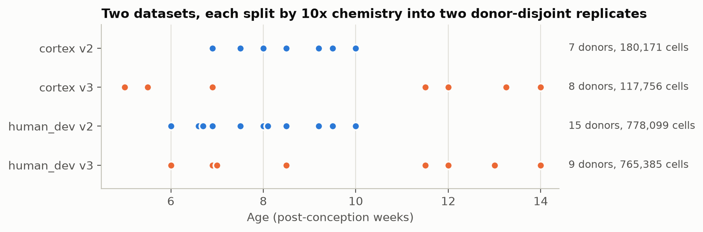
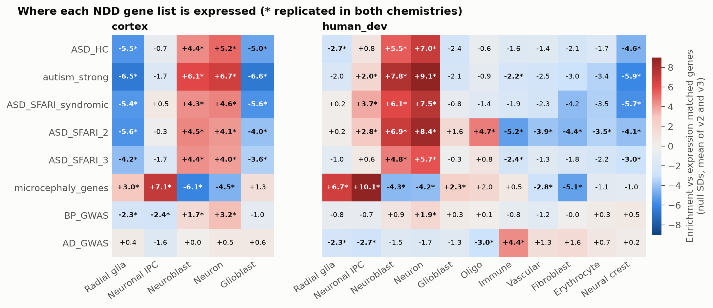
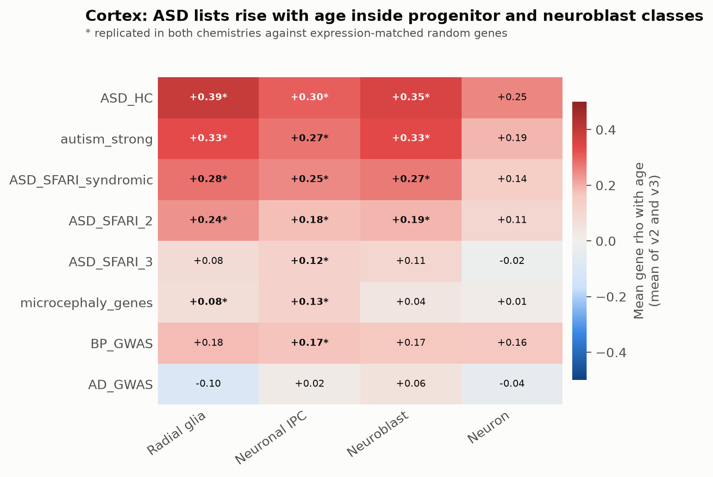
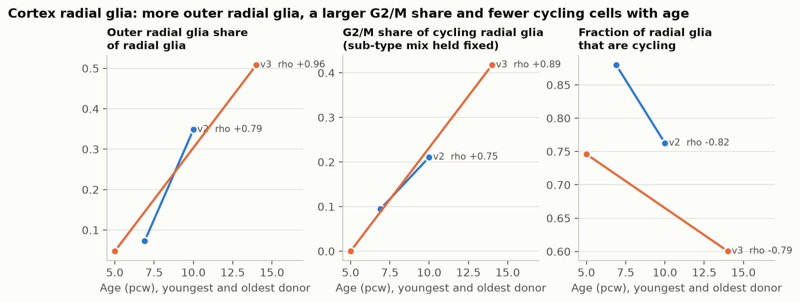
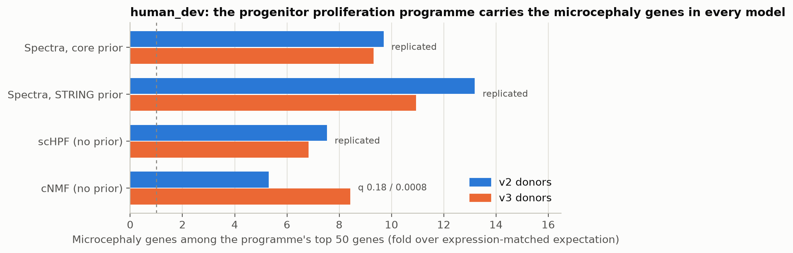
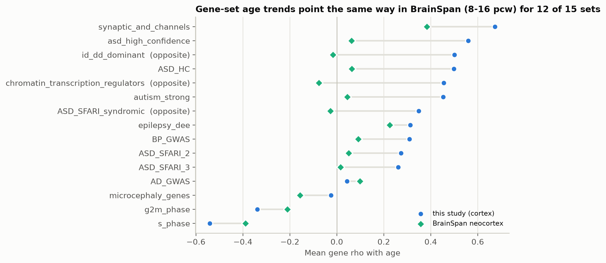

# Neurodevelopmental-disorder genes in the developing human brain

### Where they are expressed, how they change with age, and whether they form gene programmes

_Summary of the ai-adata-miner analyses (step-3 analyses 01-36), as of 13 October 2026. Figures are drawn from the
result tables by `docs/figures/make_figures.py`._

---

## Abstract

We asked where genes linked to neurodevelopmental disorders (NDDs) are expressed in the developing human brain, how
their expression changes between 5 and 14 post-conception weeks (pcw), and whether they form gene programmes of their
own. We analysed two single-cell atlases, a dorsal-cortex atlas and a whole-brain atlas (about 1.8 million cells across
the four strata; the atlases share most cortex donors). Each atlas was split by 10x chemistry (v2 or v3) into two sets of different donors, and **a result counts only
when it holds in both**.

Most of what we see confirms established biology, which validates the approach: autism (ASD) gene lists are
concentrated in neuroblasts and neurons, primary-microcephaly genes in proliferating progenitors, and Alzheimer's
GWAS genes in microglia. Three findings are, to our knowledge, less established and worth following up:

1. **ASD gene lists rise with age _inside_ progenitor and neuroblast classes** of the cortex, at the same
   differentiation stage, cell-cycle phase and cell type, and not because of proliferation genes.
2. **Cortical radial glia shift towards G2/M with age**: among cycling radial glia the G2/M share rises (about
   0.09 → 0.21 and 0.00 → 0.42 in the two donor sets) while the fraction cycling falls. This holds at a fixed mix of
   radial-glia sub-types and sequencing depth.
3. **Beyond what expression level predicts, NDD lists do not form gene programmes of their own**, with two
   exceptions: microcephaly genes sit in the progenitor proliferation programme (6.8-13.2× in three different
   models), and synaptic ASD genes sit in a glutamate-receptor network module. A prior-guided method (Spectra) that
   is given the lists simply reproduces them, which is a caution for list-guided analyses.

---

## 1. Data and design

| | cortex | human_dev |
|---|---|---|
| What it is | Dorsal (EMX1-lineage) cortex: radial glia, IPCs, neuroblasts, neurons, glioblasts | Whole developing brain: 11 cell classes incl. immune, vascular, erythroid, neural crest |
| Cells (v2 / v3) | 180,171 / 117,756 | 778,099 / 765,385 |
| Donors (v2 / v3) | 7 / 8 | 15 / 9 |
| Ages | 5-14 pcw | 6-14 pcw |

**Figure 1. Design.** Each dot is one age point; nearly every age point is one donor. The two chemistries cover
different donors (and partly different ages), so v2 and v3 serve as **two independent replicates**.

Three properties of the data shaped every analysis (analysis 01):

- **Donor is the unit of replication, and age is nested in donor**: each donor has one age, and 85% of age points
  rest on a single donor. Age effects are therefore tested across 5-11 donors per chemistry, with exact permutation
  tests.
- **The two atlases are not independent cohorts**: 13 of the 15 cortex donors are also human_dev donors. Agreement
  between the atlases shows that processing is reproducible, not that a result replicates.
- **Sex is entangled with age in the cortex donors** and inferred from expression (39/39 donor calls clean); later
  analyses check trends against sex.

**How results were tested.** Gene lists are always compared with random gene sets **matched on expression level** (and
where it matters, gene length), because NDD genes are long and highly expressed in neurons. Each chemistry gives an
effect and a p-value; they are combined (signed Stouffer, BH-corrected), and a result is **replicated** when it is
significant in both chemistries in the same direction, **supported** when the combined test is significant but one
chemistry is weak.

**Gene lists.** Nine user lists (ASD_HC, autism_strong, ASD_SFARI_syndromic, ASD_SFARI_2, ASD_SFARI_3,
microcephaly_genes, BP_GWAS and its H3 annotation, AD_GWAS) and curated panels (ASD high-confidence, ID/DD dominant,
epilepsy/DEE, chromatin regulators, synaptic genes). GWAS lists count one gene per locus.

---

## 2. Results

### 2.1 Cell composition changes as expected

Within the cortex, radial glia decline and neurons increase with age (rho −0.79/−0.95 and +0.79/+0.88 in v2/v3,
replicated). In the midbrain, glioblasts rise (+0.95/+0.99) while radial glia and neuroblasts fall. The share of
**outer radial glia** among cortical radial glia rises from 7% to 35% (v2) and 5% to 51% (v3). These match the
known course of human corticogenesis, including the expansion of outer radial glia (Hansen et al. 2010; Pollen et
al. 2015). (Analyses 02, 09, 12.)

### 2.2 Each NDD list has a clear cellular home

**Figure 2. Where each NDD list is expressed.** Enrichment of each list in each cell class over expression-matched
random genes (null standard deviations, mean of v2 and v3; * = replicated). Red = higher in that class, blue = lower.

- **ASD lists** (ASD_HC, autism_strong, ASD_SFARI tiers, syndromic) are enriched in **neuroblasts and neurons** (up
  to +9.1 SD) and depleted in radial glia and glioblasts, in both atlases.
- **Microcephaly genes** are enriched in **neuronal IPCs and radial glia** (+7 to +10 SD) and depleted in neurons.
- **AD GWAS genes** are enriched in **immune cells** (microglia; +4.4 SD), and only there.
- **BP GWAS genes** lean modestly towards neurons.
- Among cortical neurons, ASD and epilepsy genes lean towards **deep-layer** neurons (e.g. epilepsy/DEE rho
  +0.54/+0.68 with a deep-layer marker axis). (Analysis 11.)

All of this is **known biology**: ASD genes in maturing neurons (Satterstrom et al. 2020) and in deep-layer
projection neurons (Willsey et al. 2013), microcephaly genes in mitosis and centrosome function of progenitors
(Thornton & Woods 2009), AD risk genes in microglia. Reproducing it with replicated, expression-matched tests is the
validation that the pipeline measures real biology. (Analyses 04, 06.)

The lists are also internally coherent: their genes co-vary across clusters more than matched random genes (ASD_HC
mean r 0.12/0.11 vs 0.01/0.00 in cortex), they carry the expected regulators (**REST** targets in the epilepsy and
synaptic panels, 57-63×; **E2F** targets in the microcephaly list, 4-7×), and they are **loss-of-function
intolerant** (autism_strong mean LOEUF 0.38 vs 0.85-0.89 for matched genes; 94% of microcephaly genes are Mendelian
disease genes vs 27-28%). These, too, are expected properties of these lists. (Analyses 07, 30, 31.)

### 2.3 ASD lists rise with age inside progenitors and neuroblasts — _possibly new_

**Figure 3. Age trends of NDD lists within cell classes (cortex).** Mean Spearman correlation of a list's genes with
donor age inside each class (mean of v2 and v3; * = replicated against expression-matched random genes).

In the cortex, the ASD lists rise with age **within** radial glia, neuronal IPCs and neuroblasts (mean gene rho
+0.18 to +0.39, replicated, q ≈ 5 × 10⁻⁷). The trend survives every control we applied:

| Control | Result | Analysis |
|---|---|---|
| Proliferation genes removed | still rises (e.g. autism_strong in radial glia +0.34/+0.45 with cycle-independent genes only) | 09 |
| Within one cell-cycle phase | rises in G1 and G2/M separately (e.g. ASD_HC in radial glia G1 +0.25/+0.30) | 22 |
| Same differentiation stage | rises at matched pseudotime (autism_strong +0.23/+0.13) | 25 |
| Dissociation stress | no list trend halves when stress is controlled | 19 |
| Stricter cell QC | 100% of tested trends keep their sign | 28 |
| Independent atlas (BrainSpan, bulk neocortex) | same direction for ASD_HC, autism_strong, ASD_SFARI_2/3, weaker | 34 |

ASD genes are known to be most strongly co-expressed in the mid-fetal cortex and to switch on as neurons mature
(Willsey et al. 2013; Parikshak et al. 2013), and our lists do rise along differentiation (ASD_HC +0.40/+0.47 with
pseudotime). What we have not seen described is the **age ramp inside progenitors at a fixed stage**: older radial
glia and IPCs express more ASD-list genes than younger ones in the same state. It could reflect progenitors priming
neuronal genes as neurogenesis advances. **This needs a literature check and an independent replication.** In the
whole-brain atlas the same trends appear but are confounded by which regions were sampled at each age (analysis 21).

### 2.4 Cortical radial glia shift towards G2/M with age — _possibly new_

**Figure 4. Cortical radial glia over age.** Youngest and oldest donor in each chemistry, with the Spearman rho over
all age points. Outer radial glia increase, the G2/M share of cycling radial glia increases, and fewer radial glia
are cycling.

Among cycling cortical radial glia, the share in G2/M rises with age (0.09 → 0.21 in v2, 0.00 → 0.42 in v3;
replicated). It holds when the mix of outer and ventricular radial glia is held fixed, when cells are compared at the
same sequencing depth, and when truncated radial glia are removed (analyses 09, 27). Meanwhile the fraction of radial
glia that are cycling falls (0.88 → 0.76 and 0.75 → 0.60).

In rodents the classic observation is that **G1 lengthens** as neurogenesis proceeds (Takahashi et al. 1995; Calegari
& Huttner 2003), which would shrink the G2/M share. A rising G2/M share in human radial glia is therefore
interesting, but the phase calls are transcriptional, the first v3 point is a single young donor with no G2/M cells,
and the whole-brain atlas shows the same direction without significance. **Treat as a lead, not a result.**

### 2.5 Do NDD genes form gene programmes? Mostly not — _new as a systematic negative result_

We learned gene programmes four ways on the same cells: Spectra (Kunes et al. 2023) guided by core biology (GO
processes, cell cycle, cell-type markers), Spectra guided by STRING network modules (Szklarczyk et al. 2023;
experimental and curated edges only), and two methods with no prior at all, cNMF (Kotliar et al. 2019) and scHPF
(Levitin et al. 2019). None of their priors contained an NDD list, so NDD genes could be tested against programmes
they did not shape. Programmes were judged on data the fit never saw: whether they reappear in the other chemistry,
and whether their top genes co-express in the other chemistry's donors (analysis 36).

**Figure 5. The microcephaly genes sit in the progenitor proliferation programme.** Microcephaly genes among the top 50
genes of the human_dev proliferation programme, as a fold over the expectation from genes of similar expression.
Three of four models replicate it in both chemistries; cNMF reaches significance in v3.

Only three NDD results replicate in both chemistries:

| Programme | Atlas | NDD genes | Fold (v2 / v3) | Status |
|---|---|---|---|---|
| Progenitor proliferation (TOP2A, CDK1, MKI67) | human_dev | Microcephaly: ASPM, BLM, CENPJ, CIT, PLK4, POC1A, STIL | 6.8-13.2 in three models | Known biology, now robust across methods |
| STRING glutamate-receptor / PSD module (DLG4, GRIN1, GRIN2A, GRIA1/2, CACNG2) | cortex | Synaptic panel, autism_strong, ASD_SFARI_2 | 47 / 14 / 7 (module content) | Known biology; the module forms a replicated programme |
| Microglia (P2RY12, AIF1) | human_dev | AD GWAS: BIN1, SPI1, MAF | 10.3 / 14.0 | Known biology; positive control |

Beyond these, ASD lists are **not concentrated in any programme more than their expression level predicts**. Weaker,
one-chemistry hints point to chromatin regulators (CHD7, CHD8, ARID1B, AUTS2, KDM5C) in cortex programmes and to
syndromic ASD genes in a cortical-neuron programme.

Two methodological lessons, which we think are worth reporting:

- **A prior-guided model given the lists reproduces them.** When the NDD lists were part of Spectra's prior, 35 of 50
  list programmes had top genes made only of list genes, and even "free" programmes were pulled into the large lists
  through the shared gene-gene graph. List support from such a fit is circular.
- **Coherence is not concentration.** ASD lists co-vary more than random genes (section 2.2), yet they do not form
  distinct programmes: their coherence reflects shared neuronal expression, which expression-matched programme tests
  absorb.

### 2.6 Neuron types and regions

In the whole-brain atlas, about 64% of assigned neurons are inhibitory (cortex: essentially none, as expected for an
EMX1 lineage). At the same region and age, **ID/DD and chromatin-regulator panels are higher in inhibitory neurons**
(+2.4/+1.9 and +4.5/+3.5 SD) and **ASD_SFARI_2 is higher in excitatory neurons** (−2.8/−2.1 SD). ASD genes are known
to act in both neuron types (Satterstrom et al. 2020); the inhibitory lean of ID/DD and chromatin genes is **possibly
new** and needs a check. The inhibitory share of midbrain neurons rises with age (60% → 91% and 73% → 98%).
Many neurons outside the telencephalon express none of the marker genes used for the calls (up to 56% of
neuroblasts), so per-region shares there are uncertain (analysis 35).

Gene lists, panels and modules also differ between regions within a class (544 replicated class × region × set
contrasts), and these differences are not explained by the regions' ages (analysis 13).

### 2.7 What did not differ, and what held up

- **Sex**: no NDD list differs between male and female donors at the same age (positive control: Y genes and XIST
  rank first). Only X-linked escape genes (KDM5C, JPX) differ. Few male donors limit power (analysis 14).
- **Age is predictable** from expression across donor sets (rho +0.93 training on v2 and testing on v3, both
  atlases), but NDD lists predict age no better than matched random genes (analysis 16).
- **Gene length** removes 17 of 145 cell-class results and 8 of 91 age results (mostly weaker ones such as
  ASD_SFARI_3); the main ASD_HC, autism_strong and syndromic trends remain (analysis 19).
- **Stricter QC** keeps the sign of 98-100% of composition, age-trend, list and coherence results tested in both
  runs (83% for the noisier splicing results; analysis 28).
- **BrainSpan**: 67% of genes with a replicated age trend in our cortex change the same way in BrainSpan's bulk
  neocortex (50% expected by chance), and 12 of 15 gene sets move the same way (Figure 6).

**Figure 6. Independent check.** Mean gene age correlation per gene set in this study (cortex) and in BrainSpan
neocortex (11 donors, 8-16 pcw). BrainSpan trends are smaller (bulk tissue, fewer cells per sample) but mostly point
the same way.

---

## 3. What is new and what is known

| Finding | Evidence | Status |
|---|---|---|
| Radial glia decline, neurons rise; outer radial glia expand with age | Replicated (02, 09) | **Known** (Hansen et al. 2010; Pollen et al. 2015) |
| ASD lists in neuroblasts/neurons; microcephaly in progenitors; AD GWAS in microglia | Replicated in both atlases (04, 06) | **Known** (Satterstrom et al. 2020; Thornton & Woods 2009) |
| ASD and epilepsy genes lean towards deep-layer neurons | Replicated in cortex (11) | **Known** (Willsey et al. 2013) |
| NDD lists are constrained, Mendelian, REST/E2F-regulated, co-expressed | Replicated (07, 30, 31) | **Known** properties of these lists |
| Microcephaly genes form part of the proliferation programme | Replicated in three models (08, 36) | **Known** biology, shown robust to the method |
| ASD lists rise with age inside progenitors and neuroblasts at a fixed stage, phase and type | Replicated; survives five controls; same direction in BrainSpan (06, 09, 22, 25, 34) | **Possibly new** — needs literature check and replication |
| G2/M share of cycling cortical radial glia rises with age | Replicated in cortex; not significant in the whole-brain atlas (09, 27) | **Possibly new**; contrasts with rodent G1 lengthening; transcriptional phase calls |
| ID/DD and chromatin genes higher in inhibitory than excitatory neurons | Replicated in human_dev (35) | **Possibly new** — check |
| Chromatin-regulator genes co-vary more tightly later in development (ID/DD genes too, in human_dev) | Replicated in both atlases for chromatin regulators (18) | **Possibly new** — check |
| NDD lists do not form their own programmes beyond expression level (except microcephaly/proliferation, synaptic module) | Four programme models (36) | **New as a systematic negative result** |
| List-guided Spectra reproduces the lists it is given | Measured (36) | **Methodological** caution |
| The two atlases share 13 of 15 donors; XIST reads 6× higher in one file | Audit (01) | **Methodological**: cross-atlas agreement is not replication |

"Possibly new" means we have not seen it reported, not that it has been checked against the literature. Each such
finding should get a targeted literature search and, ideally, a replication in a third dataset before it is claimed.

---

## 4. Limitations

- **Few donors.** 5-11 age points per chemistry; each age point is mostly one donor. Small effects and single-gene
  trends are underpowered; gene-set tests carry the signal.
- **Chemistry and age overlap only partly.** v2 covers about 6-10 pcw and v3 adds younger and older donors, so a v2/v3
  difference can be age as well as technology.
- **Regions differ by age in the whole-brain atlas**, which confounds pooled age trends there; region-restricted
  analyses (21, 35, 36) address it but with fewer age points.
- **Transcriptional cell-cycle calls** underlie the G2/M result; they are not direct measurements of phase length.
- **Programme models used a subsample** (12,500-25,000 cells per stratum, up to 2,500 per class); activities were then
  scored on all cells, with projected and fitted activity agreeing at median r 0.99-1.00.

---

## 5. Methods in brief

Extraction scripts read the h5ad files in chunks and write per-group pseudobulks, cluster profiles and cell-level
summaries (stages 1-2). The analyses (step 3, `downstream_analyses/01-36`) work on those tables:

- **Replication:** each test runs separately in v2 and v3; signed Stouffer combination; BH correction; replicated /
  supported tiers.
- **Gene-set tests:** expression-matched (and length-matched) random gene sets as null; exact permutation p-values for
  age trends with few age points; exact Poisson-binomial p for gene-set overlaps.
- **Normalisation:** TMM log-CPM pseudobulks; cell-level CP10K.
- **Programme models:** Spectra with a plateau learning-rate rule (the package's rule stopped fits early); cNMF with one
  K per atlas chosen from stability; scHPF with cNMF's K; every cell then scored with each fit.
- **External resources:** GO, Reactome and KEGG gene sets (Enrichr), Lambert TF list and CollecTRI targets, gnomAD
  v4.1 constraint, HPO disease genes, OmniPath ligand-receptor pairs, HGNC, BrainSpan, STRING v12.

Code and documentation: this repository (`docs/ANALYSIS_CATALOG.md`, `docs/GENE_PROGRAMMES.md`,
`running_scripts/README.md`). Results: `results/<analysis>/SUMMARY.md` and its CSV tables.

---

## References

- Calegari F, Huttner WB (2003). An inhibition of cyclin-dependent kinases that lengthens, but does not arrest,
  neuroepithelial cell cycle induces premature neurogenesis. *J Cell Sci*.
- Hansen DV, Lui JH, Parker PRL, Kriegstein AR (2010). Neurogenic radial glia in the outer subventricular zone of human
  neocortex. *Nature*.
- Kotliar D et al. (2019). Identifying gene expression programs of cell-type identity and cellular activity with
  single-cell RNA-Seq. *eLife*.
- Kunes RZ et al. (2023). Supervised discovery of interpretable gene programs from single-cell data. *Nat Biotechnol*.
- Levitin HM et al. (2019). De novo gene signature identification from single-cell RNA-seq with hierarchical Poisson
  factorization. *Mol Syst Biol*.
- Parikshak NN et al. (2013). Integrative functional genomic analyses implicate specific molecular pathways and
  circuits in autism. *Cell*.
- Pollen AA et al. (2015). Molecular identity of human outer radial glia during cortical development. *Cell*.
- Satterstrom FK et al. (2020). Large-scale exome sequencing study implicates both developmental and functional changes
  in the neurobiology of autism. *Cell*.
- Szklarczyk D et al. (2023). The STRING database in 2023. *Nucleic Acids Res*.
- Takahashi T, Nowakowski RS, Caviness VS (1995). The cell cycle of the pseudostratified ventricular epithelium of the
  embryonic murine cerebral wall. *J Neurosci*.
- Thornton GK, Woods CG (2009). Primary microcephaly: do all roads lead to Rome? *Trends Genet*.
- Willsey AJ et al. (2013). Coexpression networks implicate human midfetal deep cortical projection neurons in the
  pathogenesis of autism. *Cell*.
